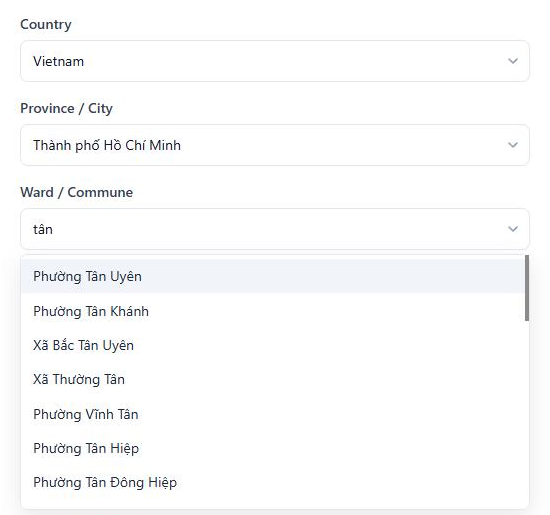
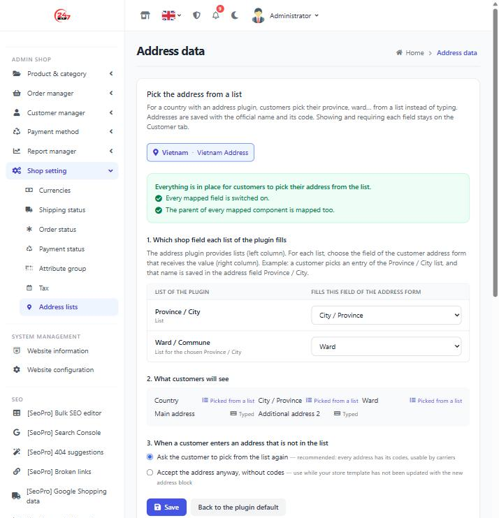

# AddressVN plugin — Vietnam Address

> 🌐 **Language:** [🇻🇳 Tiếng Việt](./readme_vi.md) · 🇬🇧 English (current) · [🇯🇵 日本語](./readme_ja.md)

Customers pick their **Province / City**, then their **Ward / Commune**, from a list when they register, edit their address
book and check out on an S-Cart store — instead of typing them. Addresses are stored with the official name plus the
administrative unit code, so every customer no longer writes the same place a different way ("Q.1", "Quận 1", "quan 1").

The list follows Vietnam's **two-level** administrative units (province → commune, since 2025-07-01) published by the
General Statistics Office, and ships inside the plugin.

---

## Overview

| | |
| --- | --- |
| **Plugin** | AddressVN |
| **Version** | 1.0.0 |
| **Developer** | GP247 |
| **License** | Free · open source, [MIT](./LICENSE) |
| **Requires** | GP247 Core **3.18+** · package `gp247/shop` **3.15+** |
| **Not needed** | New Composer packages, cron, queue, an Internet connection at run time |
| **Data** | 34 provinces / cities · 3,321 wards / communes / special zones — list dated **2026-11-24** |

## Features

- The **Province / City** and **Ward / Commune** fields become searchable lists: type without accents ("ho chi minh",
  "tan") to filter; the ward list holds only the units of the chosen province. The **Country** field is searchable too.
- Works everywhere an address is entered: registration, account details, address book, checkout; and in the admin: edit
  order, create order, customers, a customer's address book.
- Stores the **official name** on the order / address (display, invoices and exports stay as they are) together with the
  **province and ward codes** for shipping plugins and reports to use later.
- Older addresses typed by hand still open: when one is edited, the plugin matches the typed names (without accents,
  without "Phường", "Tỉnh"…) against the list. Two units whose names differ only by accents (e.g. "Xã Văn Lang" and
  "Xã Văn Lăng") are never mixed up: a name typed without accents asks the customer to pick from the list again.
- Customers in other countries type their address as before. If the list is missing or fails, the lists fall back to
  typed fields — customers can still check out.
- Enabled or disabled per store (multi-store sites).

## Installation

1. Copy the `AddressVN` folder to `app/GP247/Plugins/` on the website (or upload the ZIP file at
   **Admin → Extensions / Plugins → Import**).
2. Go to **Admin → Extensions / Plugins**, find **Vietnam Address** and click **Install**.

The plugin is enabled right after installation. A site not yet on `gp247/shop` 3.15 gets a message asking to update
S-Cart first (`composer update`, then `php artisan gp247:update`).

## Configuration

Click the plugin's settings button, or go to **Shop setting → Address lists** (also under **Website configuration → Address
tab**) and choose **Vietnam**. The screen has three steps:

1. **Which shop field each list of the plugin fills** — the left column is a list the plugin provides (Province / City,
   Ward / Commune), the right column the field of the customer address form that receives it. Defaults: Province / City →
   Province / City field, Ward / Commune → Ward field; every other field (house number, street, former district…) stays typed.
2. **What customers will see** — a preview of which fields are picked from a list and which are typed.
3. **When a customer enters an address that is not in the list** — *Ask the customer to pick from the list again* (default,
   recommended) or *Accept the address anyway, without codes* (while your store template has not been updated with the new
   address block).

The check panel at the top lists anything still missing, with a button to the place to fix it. The usual one: on **Website
configuration → Customer tab**, **switch on** the Province / City and Ward fields (and Country if you sell to several countries), and **switch off**
District — Vietnam dropped the district level on 2025-07-01 (keep it if you also sell to a country that needs it).

Uninstalling the plugin keeps the settings of this screen — reinstall and carry on.

## Updating the list

Administrative boundaries change by resolution of the National Assembly. Each plugin release states the date of its list
(Overview table). When a release with a newer list is out, update the plugin like any other — saved addresses are not
changed.

Maintainers rebuild the data file with the command shipped in the plugin:

1. Open [danhmuchanhchinh.nso.gov.vn](https://danhmuchanhchinh.nso.gov.vn/), choose **Cấp: Xã** (level: commune), set
   **Đến ngày** (as of), click **Thực Hiện** (run), then **Xuất Excel** (export).
2. From the website root: `php app/GP247/Plugins/AddressVN/tools/build-catalog.php <file.xls> <YYYY-MM-DD>`.
   The command stops without writing anything when the file has an unexpected row (wrong header, duplicate code, a
   province with two names).

## Data source

| Source | Version / date | Used for |
| --- | --- | --- |
| [Administrative unit list — General Statistics Office of Viet Nam](https://danhmuchanhchinh.nso.gov.vn/), commune level, Excel export | In force on 2026-11-24 · 34 provinces, 3,321 commune-level units (709 wards, 2,599 communes, 13 special zones) | Official codes and names of provinces / cities and wards / communes / special zones (`Data/vn-admin-units.json`) |

## Release history

- **1.0.0** — First release: province → ward lists on the storefront and in the admin, official names stored with codes,
  matching of typed names, list dated 2026-11-24.
