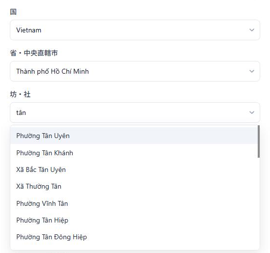
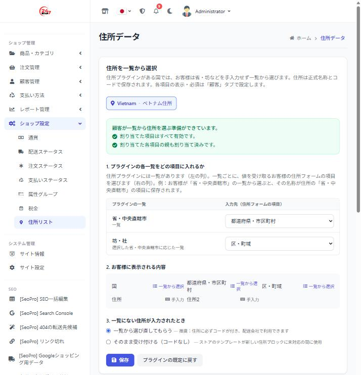

# AddressVN プラグイン — ベトナム住所

> 🌐 **言語:** [🇻🇳 Tiếng Việt](./readme_vi.md) · [🇬🇧 English](./readme.md) · 🇯🇵 日本語（現在）

S-Cart ストアの会員登録・住所録の編集・注文手続きで、お客様は **省・中央直轄市** を選び、続けて **坊・社** を一覧から
選びます（手入力の代わりに）。住所は正式名称と行政単位コードで保存されるため、同じ場所をお客様ごとに違う書き方
（"Q.1"、"Quận 1"、"quan 1"）で入力されることがなくなります。

一覧はベトナム統計総局が公表している **2 階層** の行政区画（省 → 社、2025 年 7 月 1 日から）で、プラグインに同梱
されています。

---

## 概要

| | |
| --- | --- |
| **プラグイン** | AddressVN |
| **バージョン** | 1.0.0 |
| **開発** | GP247 |
| **ライセンス** | 無料・オープンソース、[MIT](./LICENSE) |
| **必要環境** | GP247 Core **3.18+**・パッケージ `gp247/shop` **3.15+** |
| **不要** | 新しい Composer パッケージ、cron、キュー、実行時のインターネット接続 |
| **データ** | 34 省・中央直轄市・3,321 坊・社・特区 — **2026-11-24** 時点の一覧 |

## 機能

- **省・中央直轄市** と **坊・社** の欄が検索できる一覧になります。声調記号なしで入力（"ho chi minh"、"tan"）しても絞り込めます。
  坊・社の一覧には選んだ省の単位だけが表示されます。**国** の欄も同じように検索できます。
- 住所を入力するすべての画面で動作します：会員登録、アカウント情報、住所録、注文手続き。管理画面では注文の編集、
  注文の作成、顧客、顧客の住所録。
- 注文・住所には **正式名称** を保存し（表示・請求書・データ出力はこれまでどおり）、配送プラグインやレポートが後で
  使えるよう **省・坊のコード** も一緒に保存します。
- 手入力された過去の住所もそのまま開けます。編集時、入力済みの名称（声調記号なし、"Phường"・"Tỉnh" なし など）を
  一覧と照合します。声調記号だけが違う 2 つの単位（例："Xã Văn Lang" と "Xã Văn Lăng"）を取り違えることはなく、
  記号なしで入力された名称はお客様に一覧から選び直してもらいます。
- 他の国のお客様はこれまでどおり手入力します。一覧が見つからない・読み込めない場合は自動で手入力欄に戻り、
  注文は続けられます。
- ストアごとに有効・無効を切り替えられます（マルチストアのサイト）。

## インストール

1. `AddressVN` フォルダーをサイトの `app/GP247/Plugins/` にコピーします（または **管理画面 → Extensions / Plugins →
   Import** で ZIP ファイルをアップロード）。
2. **管理画面 → Extensions / Plugins** で **ベトナム住所** を探し、**Install** をクリックします。

インストール直後から有効です。`gp247/shop` 3.15 未満のサイトでは、先に S-Cart を更新するよう案内が表示されます
（`composer update` のあと `php artisan gp247:update`）。

## 設定

プラグインの設定ボタンをクリックするか、**ショップ設定 → 住所リスト**（**サイト設定 → 住所タブ** にもあります）で **ベトナム** を
選びます。画面は 3 つのステップです。

1. **プラグインの各一覧をどの項目に入れるか** — 左の列がプラグインの一覧（省・中央直轄市、坊・社）、右の列が値を受け取る
   お客様の住所フォームの項目です。既定：省・中央直轄市 → 都道府県・市区町村の項目、坊・社 → 区・町域の項目。その他の項目
   （番地、通り、旧郡 など）は手入力のままです。
2. **お客様に表示される内容** — どの項目が一覧から選択で、どの項目が手入力かのプレビュー。
3. **一覧にない住所が入力されたとき** — *一覧から選び直してもらう*（既定・推奨）または *そのまま受け付ける（コードなし）*
   （ストアのテンプレートが新しい住所ブロックに未対応の間）。

画面上部のチェック欄に不足している設定と、修正する場所へのボタンが表示されます。よくあるのは **サイト設定 → 顧客タブ** で
省・中央直轄市と坊・社の欄（複数の国に販売する場合は国の欄も）を **有効** にし、区・郡の欄を **無効** にすることです。
ベトナムは 2025 年 7 月 1 日に郡レベルを廃止しました（区・郡が必要な他の国にも販売する場合は残してください）。

プラグインをアンインストールしてもこの画面の設定は残ります。再インストールすればそのまま使えます。

## 一覧の更新

行政区画は国会の決議で変わります。各リリースは一覧の日付を明記しています（概要の表）。新しい一覧を含むリリースが
出たら、他のプラグインと同じように更新してください。保存済みの住所は変わりません。

保守担当者は、プラグインに同梱のコマンドでデータファイルを作り直せます。

1. [danhmuchanhchinh.nso.gov.vn](https://danhmuchanhchinh.nso.gov.vn/) を開き、**Cấp: Xã**（レベル：社）を選び、
   **Đến ngày**（基準日）を設定して **Thực Hiện**（実行）、続けて **Xuất Excel**（Excel 出力）をクリックします。
2. サイトのルートで：`php app/GP247/Plugins/AddressVN/tools/build-catalog.php <file.xls> <YYYY-MM-DD>`。
   想定外の行（見出しの違い、コードの重複、名称が 2 つある省）があれば、何も書き込まずに停止します。

## データの出典

| 出典 | バージョン・日付 | プラグインでの用途 |
| --- | --- | --- |
| [行政単位一覧 — ベトナム統計総局](https://danhmuchanhchinh.nso.gov.vn/)、社レベル、Excel 出力 | 2026-11-24 時点で有効・34 省、社レベル 3,321 単位（坊 709、社 2,599、特区 13） | 省・中央直轄市と坊・社・特区の正式コードと名称（`Data/vn-admin-units.json`） |

## リリース履歴

- **1.0.0** — 初回リリース：ストアフロントと管理画面での省 → 坊・社の選択、正式名称とコードの保存、手入力名称の照合、
  2026-11-24 時点の一覧。
