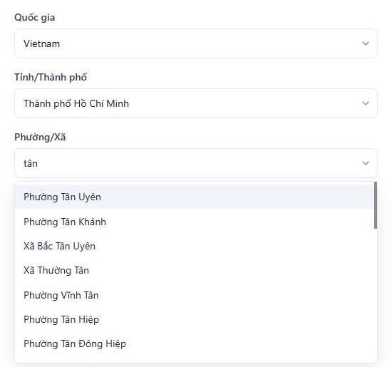
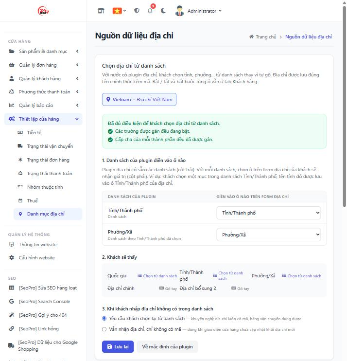

# Plugin AddressVN — Địa chỉ Việt Nam

> 🌐 **Ngôn ngữ:** 🇻🇳 Tiếng Việt (hiện tại) · [🇬🇧 English](./readme.md) · [🇯🇵 日本語](./readme_ja.md)

Khách chọn **Tỉnh/Thành phố** rồi chọn **Phường/Xã** từ danh sách khi đăng ký, sửa sổ địa chỉ và đặt hàng trên cửa hàng
S-Cart — thay cho việc tự gõ. Địa chỉ được lưu bằng tên chính thức kèm mã đơn vị hành chính, nên không còn cảnh mỗi khách
viết một kiểu ("Q.1", "Quận 1", "quan 1").

Danh mục dùng địa giới **hai cấp** (tỉnh → xã, từ 01/7/2025) do Cục Thống kê công bố, đóng gói sẵn trong plugin.

---

## Tổng quan

| | |
| --- | --- |
| **Plugin** | AddressVN |
| **Phiên bản** | 1.0.0 |
| **Nhà phát triển** | GP247 |
| **Giấy phép** | Miễn phí · mã nguồn mở, [MIT](./LICENSE) |
| **Yêu cầu** | GP247 Core **3.18+** · package `gp247/shop` **3.15+** |
| **Không cần** | Composer package mới, cron, queue, kết nối Internet lúc chạy |
| **Danh mục** | 34 tỉnh/thành phố · 3.321 phường/xã/đặc khu — bản ngày **24/11/2026** |

## Tính năng

- Ô **Tỉnh/Thành phố** và **Phường/Xã** thành danh sách chọn có ô tìm: gõ không dấu ("ho chi minh", "tan") là lọc ra;
  danh sách phường/xã chỉ gồm đơn vị của tỉnh đã chọn. Ô **Quốc gia** cũng tìm được như vậy.
- Áp dụng ở mọi nơi nhập địa chỉ: đăng ký, thông tin tài khoản, sổ địa chỉ, bước đặt hàng; và ở màn quản trị: sửa đơn,
  tạo đơn, khách hàng, sổ địa chỉ của khách.
- Lưu **tên chính thức** vào đơn hàng / địa chỉ (hiển thị, in hoá đơn, xuất dữ liệu vẫn như cũ) kèm **mã tỉnh, mã xã** để
  plugin vận chuyển hay báo cáo dùng về sau.
- Địa chỉ cũ gõ tay vẫn mở được: khi sửa, plugin tự khớp tên đã gõ (không dấu, thiếu chữ "Phường", "Tỉnh"…) với danh mục.
  Hai đơn vị chỉ khác nhau ở dấu (vd "Xã Văn Lang" và "Xã Văn Lăng") không bao giờ bị khớp nhầm: gõ không dấu thì khách
  được yêu cầu chọn lại từ danh sách.
- Khách ở nước khác vẫn gõ địa chỉ như thường. Danh mục lỗi hoặc thiếu thì ô chọn tự trở về ô nhập tay — khách vẫn đặt
  được hàng.
- Bật/tắt theo từng cửa hàng (site nhiều cửa hàng).

## Cài đặt

1. Chép thư mục `AddressVN` vào `app/GP247/Plugins/` trên website (hoặc tải file ZIP lên ở
   **Admin → Extensions / Plugins → Import**).
2. Vào **Admin → Extensions / Plugins**, tìm **Địa chỉ Việt Nam** và bấm **Install**.

Plugin được bật ngay sau khi cài. Site chưa cập nhật lên `gp247/shop` 3.15 sẽ thấy thông báo cần cập nhật S-Cart trước
(`composer update` rồi `php artisan gp247:update`).

## Cấu hình

Bấm nút cài đặt của plugin, hoặc vào **Thiết lập cửa hàng → Danh mục địa chỉ** (cũng có ở **Cấu hình website → tab Địa chỉ**),
chọn **Việt Nam**. Màn chia ba bước:

1. **Danh sách của plugin điền vào ô nào** — cột trái là danh sách plugin có (Tỉnh/Thành phố, Phường/Xã), cột phải là ô trên
   form địa chỉ của khách nhận giá trị. Mặc định: Tỉnh/Thành phố → ô Tỉnh/Thành phố, Phường/Xã → ô Phường/Xã; các ô khác
   (số nhà, đường, quận/huyện cũ…) vẫn gõ tay.
2. **Khách sẽ thấy** — xem trước ô nào chọn từ danh sách, ô nào gõ tay.
3. **Khi khách nhập địa chỉ không có trong danh sách** — *Yêu cầu khách chọn lại từ danh sách* (mặc định, khuyến nghị) hoặc
   *Vẫn nhận địa chỉ, chỉ không có mã* (dùng khi giao diện cửa hàng chưa cập nhật khối địa chỉ mới).

Khung kiểm tra ở đầu màn báo những gì còn thiếu, kèm nút mở đúng chỗ sửa. Việc thường gặp nhất: ở **Cấu hình website → tab
Khách hàng**, **bật** ô Tỉnh/Thành phố và Phường/Xã (và ô Quốc gia nếu bạn bán cho nhiều nước), và **tắt** ô Quận/Huyện —
Việt Nam bỏ cấp huyện từ 01/7/2025 (giữ ô này nếu bạn còn bán cho nước khác cần quận/huyện).

Gỡ plugin không xoá cấu hình ở màn này — cài lại là dùng tiếp.

## Cập nhật danh mục

Địa giới hành chính thay đổi theo nghị quyết của Quốc hội. Mỗi bản plugin ghi rõ ngày của danh mục (bảng Tổng quan).
Khi có bản plugin mới với danh mục mới hơn, cập nhật plugin như mọi plugin khác — địa chỉ đã lưu không bị thay đổi.

Người bảo trì dựng lại file danh mục bằng lệnh có sẵn trong plugin:

1. Mở [danhmuchanhchinh.nso.gov.vn](https://danhmuchanhchinh.nso.gov.vn/), chọn **Cấp: Xã**, chọn **Đến ngày**, bấm
   **Thực Hiện** rồi **Xuất Excel**.
2. Từ thư mục gốc website: `php app/GP247/Plugins/AddressVN/tools/build-catalog.php <file.xls> <YYYY-MM-DD>`.
   Lệnh dừng mà không ghi gì nếu file có dòng bất thường (sai tiêu đề, trùng mã, một tỉnh hai tên).

## Nguồn dữ liệu

| Nguồn | Phiên bản / ngày | Plugin dùng để |
| --- | --- | --- |
| [Danh mục đơn vị hành chính — Cục Thống kê](https://danhmuchanhchinh.nso.gov.vn/), cấp Xã, xuất Excel | Hiệu lực đến ngày 24/11/2026 · 34 tỉnh, 3.321 đơn vị cấp xã (709 phường, 2.599 xã, 13 đặc khu) | Mã và tên chính thức của tỉnh/thành phố và phường/xã/đặc khu (`Data/vn-admin-units.json`) |

## Lịch sử phiên bản

- **1.0.0** — Phát hành đầu tiên: chọn tỉnh → phường/xã ở storefront và màn quản trị, lưu tên chính thức kèm mã, khớp tên
  gõ tay, danh mục ngày 24/11/2026.
